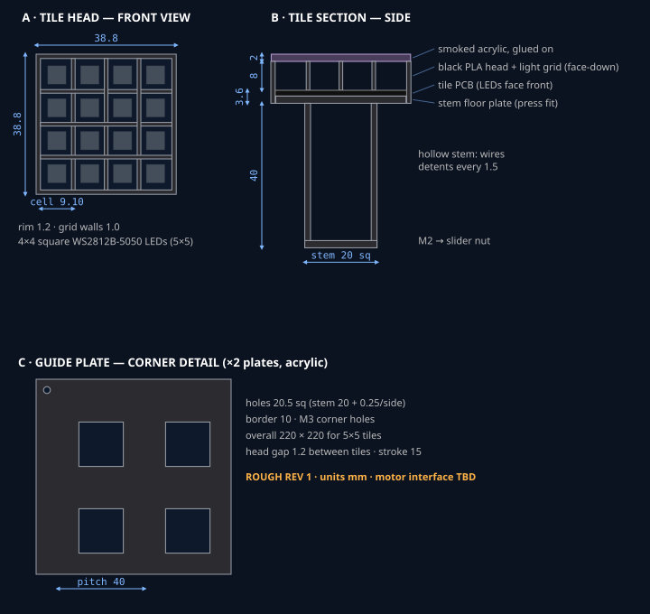

# board-eng — Kinetic Dither Board

A school engineering-design project: a **mechanical, kinetic 3D version of a dither effect**. It's a square board of moving tiles, and each tile carries a grid of square RGB pixels. The lights draw a fine dither pattern; the tiles slide in and out to add slow, calming 3D motion and a soft mechanical-keyboard-like sound.

**Problem it addresses:** during short, unpredictable waits in focused work (AI tools, builds, renders), people reach for their phones and doomscroll. The board is a screen-free, calming desk object that gives idle attention somewhere to rest.

## Repo layout

| Path | What |
|---|---|
| [`ingredients.md`](ingredients.md) | Full parts list (quantities in terms of N tiles per side and k LEDs per tile side) |
| [`context.md`](context.md) | All design decisions, constraints and history, enough to hand the project to someone else |
| [`tile-design.html`](tile-design.html) | Early concept diagram (exploded tile, board section, front view) |
| [`cad/tile.py`](cad/tile.py) | Parametric generator for every tile and laser part |
| [`cad/out/`](cad/out) | Generated files, ready to print or cut |

### Generated parts (`cad/out/`)

| File | Make with | Qty |
|---|---|---|
| `tile_head.stl` | Prusa MK4S, black PLA, **face-down** | N² |
| `tile_stem.stl` | Prusa MK4S, black PLA, upright | N² |
| `test_clearance_coupon.stl` | Print first, to tune the stem ↔ guide fit | 1 |
| `laser_diffusers_smoked.svg` | Laser, smoked "LED" acrylic ~2 mm | 1 sheet |
| `laser_front_bezel_black.svg` | Laser, black acrylic 3 mm | 1 |
| `laser_guide_plate_x2.svg` | Laser, clear acrylic 3 mm | 2 |
| `blueprint_tile.svg` | Dimensioned drawing | — |



## Regenerating

```sh
python3 -m venv .venv
.venv/bin/pip install manifold3d numpy trimesh
.venv/bin/python cad/tile.py
```

Edit the `PARAMETERS` block in `cad/tile.py` (grid size, pitch, gaps, clearances, stroke) and rerun.

## Status

Rough rev 2. The motor plate and slider interface wait on measurements of the real 8 mm micro slider stepper. Next step: a single-tile prototype.
